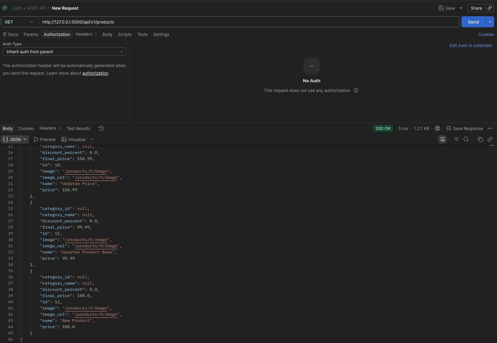
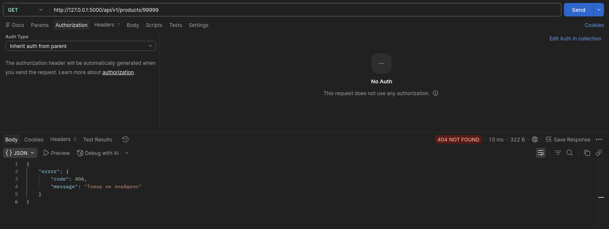
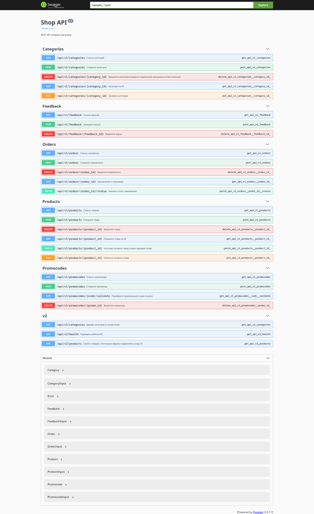

# Лабораторна робота №5

## REST API інтернет-магазину

## 1. Загальна інформація

**Назва проєкту:** Shop — інтернет-магазин

**Мова програмування:** Python

### Склад команди

| №   | Учасник         | GitHub                                             |
| --- | --------------- | -------------------------------------------------- |
| 1   | Рудь Максим     | [@awaikoi](https://github.com/awaikoi)             |
| 2   | Шутовська Марта | [@YotsubaNikano](https://github.com/YotsubaNikano) |
| 3   | Комарук Марк    | [@ItsukiNikano](https://github.com/ItsukiNikano)   |
| 4   | Засєкін Ілля    | [@NikanoNino](https://github.com/NikanoNino)       |
| 5   | Ковтун Каріна   | [@k7912341-bit](https://github.com/k7912341-bit)   |

---

## 2. Опис проєкту

Проєкт являє собою вебзастосунок інтернет-магазину з реалізованим REST API.

Основні можливості:

- Перегляд, створення, редагування та видалення товарів.
- Управління категоріями товарів.
- Створення та управління замовленнями.
- Створення та перевірка промокодів.
- Отримання та управління відгуками.
- Фільтрація, сортування та пошук товарів.
- Підтримка двох версій API.
- Документування API за допомогою Swagger.
- Перевірка та валідація вхідних даних.

### Використані технології

| Технологія       | Призначення                |
| ---------------- | -------------------------- |
| Python           | Основна мова програмування |
| Flask 3.1.3      | Вебфреймворк               |
| SQLite           | Реляційна база даних       |
| Flasgger 0.9.7.1 | Документування API         |
| Swagger          | Опис API                   |
| JSON             | Формат обміну даними       |
| Werkzeug         | Обробка HTTP-запитів       |
| Postman          | Тестування API             |

---

## 3. Опис API

API побудовано відповідно до принципів REST. Для взаємодії з сервером використовуються HTTP-методи GET, POST, PUT, PATCH та DELETE.

Реалізовано дві версії API:

- **v1:** `/api/v1/` — основний набір функцій магазину.
- **v2:** `/api/v2/` — розширена версія з пагінацією та додатковими можливостями.

### 3.1. API v1 — Товари

| Метод  | Адреса                  | Призначення               | Коди          |
| ------ | ----------------------- | ------------------------- | ------------- |
| GET    | `/api/v1/products`      | Отримання списку товарів  | 200, 400      |
| GET    | `/api/v1/products/{id}` | Отримання товару за ID    | 200, 404      |
| POST   | `/api/v1/products`      | Створення товару          | 201, 400      |
| PUT    | `/api/v1/products/{id}` | Повне оновлення товару    | 200, 400, 404 |
| PATCH  | `/api/v1/products/{id}` | Часткове оновлення товару | 200, 400, 404 |
| DELETE | `/api/v1/products/{id}` | Видалення товару          | 204, 404, 409 |

Додаткові можливості отримання товарів:

- Пошук за назвою (`q`).
- Фільтрація за категорією (`category_id`).
- Фільтрація за ціною (`min_price`, `max_price`).
- Перегляд товарів зі знижкою (`on_sale`).
- Сортування (`sort`).

### 3.2. API v1 — Категорії

| Метод  | Адреса                    | Призначення                | Коди          |
| ------ | ------------------------- | -------------------------- | ------------- |
| GET    | `/api/v1/categories`      | Отримання списку категорій | 200           |
| GET    | `/api/v1/categories/{id}` | Отримання категорії за ID  | 200, 404      |
| POST   | `/api/v1/categories`      | Створення категорії        | 201, 400      |
| PUT    | `/api/v1/categories/{id}` | Оновлення категорії        | 200, 400, 404 |
| DELETE | `/api/v1/categories/{id}` | Видалення категорії        | 204, 404      |

### 3.3. API v1 — Замовлення

| Метод  | Адреса                       | Призначення                | Коди          |
| ------ | ---------------------------- | -------------------------- | ------------- |
| GET    | `/api/v1/orders`             | Отримання списку замовлень | 200, 400      |
| GET    | `/api/v1/orders/{id}`        | Отримання замовлення за ID | 200, 404      |
| POST   | `/api/v1/orders`             | Створення замовлення       | 201, 400      |
| PATCH  | `/api/v1/orders/{id}/status` | Зміна статусу замовлення   | 200, 400, 404 |
| DELETE | `/api/v1/orders/{id}`        | Видалення замовлення       | 204, 404      |

### 3.4. API v1 — Промокоди

| Метод  | Адреса                               | Призначення                 | Коди          |
| ------ | ------------------------------------ | --------------------------- | ------------- |
| GET    | `/api/v1/promocodes`                 | Отримання списку промокодів | 200           |
| POST   | `/api/v1/promocodes`                 | Створення промокоду         | 201, 400, 409 |
| GET    | `/api/v1/promocodes/{code}/validate` | Перевірка промокоду         | 200, 400, 404 |
| DELETE | `/api/v1/promocodes/{id}`            | Видалення промокоду         | 204, 404      |

### 3.5. API v1 — Відгуки

| Метод  | Адреса                  | Призначення               | Коди     |
| ------ | ----------------------- | ------------------------- | -------- |
| GET    | `/api/v1/feedback`      | Отримання списку відгуків | 200      |
| POST   | `/api/v1/feedback`      | Створення відгуку         | 201, 400 |
| DELETE | `/api/v1/feedback/{id}` | Видалення відгуку         | 204, 404 |

### 3.6. API v2

| Метод | Адреса               | Призначення                     | Коди     |
| ----- | -------------------- | ------------------------------- | -------- |
| GET   | `/api/v2/health`     | Перевірка стану API             | 200      |
| GET   | `/api/v2/products`   | Отримання товарів із пагінацією | 200, 400 |
| GET   | `/api/v2/categories` | Отримання дерева категорій      | 200      |

Для отримання товарів у v2 підтримуються параметри:

- `page` — номер сторінки.
- `per_page` — кількість товарів на сторінці (від 1 до 100).
- `q` — пошуковий запит.
- `category_id` — ідентифікатор категорії.
- `min_price`, `max_price` — межі ціни.
- `on_sale` — фільтр товарів зі знижкою.
- `sort` — спосіб сортування.

Відповідь містить масив `data` та об'єкт `meta` з інформацією про пагінацію.

---

## 4. Результати тестування

Тестування API проводилося за допомогою Postman.

### 4.1. Успішний запит

**Метод:** GET

**Адреса:** `/api/v1/products`

**Очікуваний результат:** HTTP 200 OK та отримання списку товарів у форматі JSON.

**Скріншот:**



### 4.2. Запит з помилкою

**Метод:** GET

**Адреса:** `/api/v1/products/99999`

**Очікуваний результат:** HTTP 404 Not Found, оскільки товар із вказаним ідентифікатором відсутній.

**Скріншот:**



### 4.3. Обробка помилок

Для API реалізовано централізовану обробку помилок.

Формат відповіді:

```json
{
    "error": {
        "code": 404,
        "message": "Товар не знайдено"
    }
}
```

За необхідності відповідь також містить поле `details` з додатковою інформацією про помилку.

Використовуються такі HTTP-коди:

- `200` — успішне виконання запиту.
- `201` — ресурс створено.
- `204` — ресурс видалено.
- `400` — помилка валідації або некоректний запит.
- `404` — ресурс не знайдено.
- `409` — конфлікт даних.
- `413` — перевищено допустимий розмір запиту.
- `500` — внутрішня помилка сервера.

---

## 5. Документація, валідація та версії API

### 5.1. Документація API

Для документування API використовується Swagger через бібліотеку Flasgger.

Документація доступна за адресою:

`http://127.0.0.1:5000/apidocs/`

Вона дозволяє переглядати доступні ендпоінти, HTTP-методи, параметри запитів, структури відповідей та можливі коди помилок.

**Скріншот документації:**



### 5.2. Валідація даних

У проєкті реалізовано власну систему валідації вхідних даних.

Перевірка здійснюється за такими правилами:

- Наявність обов'язкових полів.
- Відповідність значень очікуваним типам даних.
- Перевірка мінімальних та максимальних значень.
- Обмеження довжини текстових полів.
- Перевірка коректності адрес електронної пошти.
- Перевірка формату дати `РРРР-ММ-ДД`.
- Перевірка допустимих значень полів.
- Перевірка числових значень на коректність.
- Перевірка існування пов'язаних ресурсів.

Для часткового оновлення товарів через PATCH використовується режим часткової валідації.

У разі виявлення помилок сервер повертає HTTP 400 та JSON-відповідь з описом проблемних полів.

### 5.3. Версіонування API

У проєкті реалізовано дві версії API за допомогою окремих Flask Blueprint.

**API v1 (`/api/v1/`):**

- Основний функціонал інтернет-магазину.
- Управління товарами, категоріями, замовленнями, промокодами та відгуками.
- Підтримка повного та часткового оновлення ресурсів.

**API v2 (`/api/v2/`):**

- Додаткові можливості роботи з товарами.
- Підтримка пагінації.
- Отримання дерева категорій.
- Перевірка стану API через health endpoint.

Версіонування дозволяє розширювати функціональність API без необхідності змінювати вже реалізовані маршрути попередньої версії.

---

## 6. Висновки

Під час виконання лабораторної роботи було розроблено REST API для вебзастосунку інтернет-магазину.

У процесі роботи:

- Реалізовано HTTP-ендпоінти для роботи з основними ресурсами магазину.
- Налаштовано взаємодію з базою даних SQLite.
- Реалізовано обробку HTTP-помилок.
- Створено систему валідації вхідних даних.
- Додано документування API за допомогою Swagger.
- Реалізовано версіонування API.
- Додано пагінацію та розширені можливості фільтрації даних.

У результаті роботи отримано практичні навички розробки REST API, роботи з Flask, SQLite, HTTP-запитами, валідацією даних та документуванням програмних інтерфейсів.
